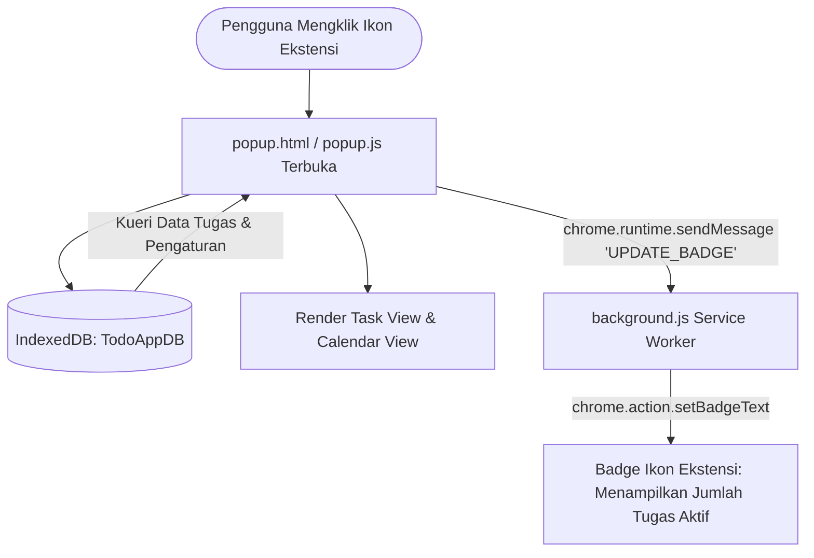
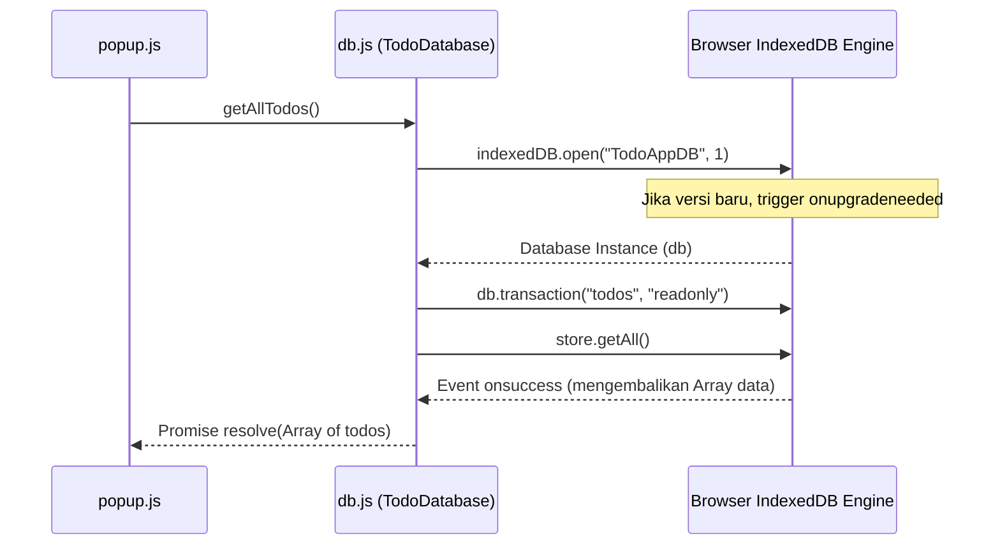

# MODUL LENGKAP: ARSITEKTUR, BEDAH KODE, DAN PANDUAN PENGEMBANGAN
## EKSTENSI CHROME "MINIMALIST TO-DO LIST" (MANIFEST V3)

Dokumen ini disusun sebagai panduan teknis komprehensif untuk memahami seluruh arsitektur, cara kerja basis data (database), analisis kode per baris/fungsi, panduan modifikasi, serta skenario penanganan berbagai kendala teknis (edge cases) pada ekstensi Chrome **Minimalist To-Do List**.

---

## DAFTAR ISI
1. [BAB 1: Arsitektur Ekstensi Chrome & Alur Kerja Sistem](#bab-1-arsitektur-ekstensi-chrome--alur-kerja-sistem)
2. [BAB 2: Cara Kerja Basis Data (IndexedDB) Secara Mendalam](#bab-2-cara-kerja-basis-data-indexeddb-secara-mendalam)
3. [BAB 3: Bedah Kode Lengkap & Penjelasan Fungsi Setiap File](#bab-3-bedah-kode-lengkap--penjelasan-fungsi-setiap-file)
   - [3.1 manifest.json](#31-manifestjson)
   - [3.2 background.js](#32-backgroundjs)
   - [3.3 db.js](#33-dbjs)
   - [3.4 popup.html](#34-popuphtml)
   - [3.5 popup.css](#35-popupcss)
   - [3.6 popup.js](#36-popupjs)
4. [BAB 4: Panduan Modifikasi & Kustomisasi (Bagaimana Jika Dirubah?)](#bab-4-panduan-modifikasi--kustomisasi-bagaimana-jika-dirubah)
   - [4.1 Menambahkan Field Baru (Prioritas, Tag, Kategori)](#41-menambahkan-field-baru-prioritas-tag-kategori)
   - [4.2 Migrasi Versi Skema Database (onupgradeneeded)](#42-migrasi-versi-skema-database-onupgradeneeded)
   - [4.3 Mengganti Storage Engine (chrome.storage.local / REST API / SQLite WASM)](#43-mengganti-storage-engine-chromestoragelocal--rest-api--sqlite-wasm)
   - [4.4 Mengubah Menjadi Chrome Side Panel API](#44-mengubah-menjadi-chrome-side-panel-api)
   - [4.5 Menambahkan Fitur Dark Mode Otomatis](#45-menambahkan-fitur-dark-mode-otomatis)
5. [BAB 5: Analisis Masalah, Edge Cases, dan Troubleshooting](#bab-5-analisis-masalah-edge-cases-dan-troubleshooting)
   - [5.1 Penanganan Error "Cannot access a chrome:// URL"](#51-penanganan-error-cannot-access-a-chrome-url)
   - [5.2 Penanganan Error "The message port closed before a response was received"](#52-penanganan-error-the-message-port-closed-before-a-response-was-received)
   - [5.3 Sifat Transient Popup Chrome & Cara Menjaga State](#53-sifat-transient-popup-chrome--cara-menjaga-state)
   - [5.4 Fitur Backup & Restore (Export / Import JSON)](#54-fitur-backup--restore-export--import-json)
   - [5.5 Skalabilitas Data Besar (IndexedDB Cursors vs getAll)](#55-skalabilitas-data-besar-indexeddb-cursors-vs-getall)

---

## BAB 1: Arsitektur Ekstensi Chrome & Alur Kerja Sistem

### 1.1 Evolusi Arsitektur: Dari Content Script Injection ke Action Popup
Pada fase awal perancangan, ekstensi ini sempat dirancang dengan pendekatan *floating widget overlay* (menginjeksi DOM HTML ke dalam halaman web aktif pengguna via `chrome.scripting.executeScript`). Namun, pendekatan tersebut memiliki batasan keamanan Chromium yang sangat ketat:
- **Pelanggaran Keamanan Halaman Internal:** Script tidak diizinkan masuk ke halaman internal browser seperti `chrome://extensions`, `chrome://newtab`, `chrome://settings`, maupun Chrome Web Store. Jika pengguna mengklik ekstensi pada tab tersebut, browser melempar error fatal `Error: Cannot access a chrome:// URL`.
- **Konflik CSS:** Gaya CSS halaman web eksternal dapat merusak tampilan widget kecuali jika dibungkus dalam *Shadow DOM*.
- **Pemuatan Berulang:** Setiap tab memiliki konteks memori terisolasi yang memerlukan mekanisme sinkronisasi data antar-tab.

**Solusi Standar Resmi (Manifest V3):**
Ekstensi dialihkan menggunakan arsitektur **Action Popup** (`default_popup: "popup.html"`). Pendekatan ini adalah standar emas aplikasi produktivitas peramban:
1. **Dapat dibuka di tab mana saja**, termasuk tab kosong (`about:blank`), tab internal `chrome://`, maupun halaman web terproteksi tanpa error perizinan.
2. **Tidak memerlukan server lokal (Localhost)**: Semua aset HTML, CSS, JavaScript berjalan langsung dari bundle ekstensi (`chrome-extension://<EXTENSION_ID>/popup.html`).
3. **Terisolasi dan Aman**: Popup memiliki lingkungan JavaScript tersendiri dengan origin ekstensi yang aman.



### 1.2 Struktur Komponen Direktori
```text
/home/splev/Projects/UKK/
├── manifest.json       # Metadata & deklarasi perizinan Manifest V3
├── background.js      # Service worker di latar belakang (badge updater)
├── db.js              # Abstraksi koneksi & operasi IndexedDB
├── popup.html         # Struktur tampilan visual popup (HTML5)
├── popup.css          # Desain sistem UI Light Minimalist Modern
├── popup.js           # Kontroler logika, state, Shadcn picker, & calendar
└── icons/             # Aset ikon ekstensi (16x16, 48x48, 128x128)
```

---

## BAB 2: Cara Kerja Basis Data (IndexedDB) Secara Mendalam

### 2.1 Mengapa IndexedDB dan Bukan LocalStorage atau SQLite?
Dalam pengembangan ekstensi peramban modern, pemilihan media penyimpanan sangat menentukan ketahanan (*persistence*), kecepatan, dan skalabilitas data:

| Parameter | `localStorage` | `chrome.storage.local` | `IndexedDB` (Pilihan Sistem Ini) | `SQLite` (via WASM) |
| :--- | :--- | :--- | :--- | :--- |
| **Batas Kapasitas** | Maksimal 5 MB | ~10 MB (bisa `unlimitedStorage`) | Ratusan Megabyte (hingga kuota disk lokal) | Bergantung memori WebAssembly |
| **Tipe Data** | Hanya *String* (perlu `JSON.stringify`) | Objek JS bebas | Objek JS terstruktur asli, Binary/Blob | Relasional tabel biner |
| **Sifat Operasi** | *Synchronous* (memblokir rendering UI) | *Asynchronous* (Callback/Promise) | *Asynchronous* murni via Event/Promise | Asinkron via WebAssembly |
| **Pengindeksan (Index)** | Tidak ada (pencarian manual linear $O(n)$) | Tidak ada | **Ada indeks sekunder $O(\log n)$** | Ada indeks B-Tree |
| **Ketergantungan Lib** | Tanpa library | API bawaan Chrome | Bawaan peramban (zero-dependency) | Butuh file `.wasm` berukuran 1-2 MB |

### 2.2 Skema Database `TodoAppDB`
Database ini dibuat dengan nama `TodoAppDB` pada versi skema `1`. Di dalamnya terdapat 2 *Object Stores* (analog dengan "tabel" pada database relasional):

#### 1. Object Store `todos`
Tempat menyimpan seluruh item tugas pengguna.
- **Primary Key (`keyPath`):** `id` (string unik, format: `"todo_<timestamp>_<random>"`).
- **Indeks yang Terpasang:**
  - `idx_dueDate`: Mengindeks atribut `dueDate` (string format ISO `YYYY-MM-DD`). Digunakan untuk kueri cepat pada Tab Kalender.
  - `idx_completed`: Mengindeks atribut `completed` (boolean `true`/`false`). Digunakan untuk filter cepat status tugas.
  - `idx_createdAt`: Mengindeks waktu pembuatan (integer Unix timestamp milidetik).

**Struktur Data Dokumen Todo:**
```json
{
  "id": "todo_1731234567890_x8z2a",
  "text": "Menyelesaikan laporan teknis UKK",
  "dueDate": "2026-11-10",
  "completed": false,
  "createdAt": 1731234567890,
  "updatedAt": 1731234567890
}
```

#### 2. Object Store `settings`
Menyimpan konfigurasi pengguna (misalnya tab aktif terakhir, preferensi filter, atau konfigurasi tema).
- **Primary Key (`keyPath`):** `key` (string).
- **Struktur Dokumen:** `{ "key": "lastActiveTab", "value": "calender" }`.

### 2.3 Mekanisme Transaksi & Siklus Hidup IndexedDB
IndexedDB adalah database transaksional. Setiap operasi tulis (`add`, `put`, `delete`) maupun baca (`get`, `getAll`) **wajib** berada di dalam sebuah transaksi dengan mode:
- `"readonly"`: Hanya untuk membaca data. Memungkinkan konkurensi tinggi tanpa saling mengunci (*non-blocking*).
- `"readwrite"`: Untuk mengubah data. Mengunci object store terkait hingga transaksi di-*commit* secara otomatis oleh browser.



---

## BAB 3: Bedah Kode Lengkap & Penjelasan Fungsi Setiap File

### 3.1 `manifest.json`
Berkas manifes adalah kontrak utama antara ekstensi dan mesin browser Chromium.

```json
{
  "manifest_version": 3,
  "name": "Minimalist To-Do List",
  "version": "1.0.0",
  "description": "Ekstensi To-Do List minimalis, cepat, dan modern berbasis IndexedDB dengan Shadcn/ui Date Picker.",
  "permissions": [
    "storage"
  ],
  "background": {
    "service_worker": "background.js"
  },
  "action": {
    "default_title": "To-Do List",
    "default_popup": "popup.html",
    "default_icon": {
      "16": "icons/icon16.png",
      "48": "icons/icon48.png",
      "128": "icons/icon128.png"
    }
  },
  "icons": {
    "16": "icons/icon16.png",
    "48": "icons/icon48.png",
    "128": "icons/icon128.png"
  }
}
```

#### Analisis Fungsi Baris Kode:
- `manifest_version: 3`: Menentukan penggunaan standar Manifest V3 terbaru dari Google yang mewajibkan Service Worker dan menonaktifkan kode jarak jauh (*remote code execution*) untuk alasan keamanan.
- `permissions: ["storage"]`: Mengizinkan akses ke API penyimpanan ekstensi peramban.
- `background.service_worker: "background.js"`: Mendaftarkan service worker yang berjalan di background tanpa membebani konsumsi RAM terus-menerus. Service worker ini akan dibangunkan saat ada event dan tidur saat menganggur.
- `action.default_popup: "popup.html"`: Kunci utama yang memerintahkan Chrome untuk membuka jendela `popup.html` saat ikon ekstensi di toolbar diklik, menggantikan teknik lama yang memerlukan `tabs.create` atau script injection.
- `icons`: Menyediakan aset grafis ikon peramban dalam resolusi standar 16px (favicon), 48px (halaman ekstensi), dan 128px (Chrome Web Store).

---

### 3.2 `background.js`
Service worker ringan yang bertugas memperbarui lencana (*badge*) jumlah tugas di toolbar browser dan merespons pesan sistem.

```javascript
/**
 * Background Service Worker (Manifest V3)
 * Bertanggung jawab mengelola badge counter dan inisialisasi ekstensi
 */

// Listener untuk pesan pembaruan badge counter dari popup
chrome.runtime.onMessage.addListener((message, sender, sendResponse) => {
  if (message && message.action === "UPDATE_BADGE") {
    const count = typeof message.count === "number" ? message.count : 0;
    const badgeText = count > 0 ? String(count) : "";

    chrome.action.setBadgeText({ text: badgeText });
    chrome.action.setBadgeBackgroundColor({ color: "#2563eb" });
    sendResponse({ success: true });
    return false; // Respons sinkron, tutup port pesan segera
  }
  return false;
});

// Inisialisasi saat ekstensi pertama kali di-install
chrome.runtime.onInstalled.addListener(() => {
  chrome.action.setBadgeText({ text: "" });
});
```

#### Analisis Fungsi Baris Kode:
- `chrome.runtime.onMessage.addListener(...)`: Mendengarkan pesan yang dikirim dari `popup.js` melalui API perpesanan internal Chrome.
- `message.action === "UPDATE_BADGE"`: Menyaring pesan spesifik yang meminta pembaruan teks lencana toolbar.
- `chrome.action.setBadgeText({ text: badgeText })`: Menampilkan angka tugas aktif di atas ikon toolbar. Jika nilai `count === 0`, badge dikosongkan string `""`.
- `chrome.action.setBadgeBackgroundColor({ color: "#2563eb" })`: Mengatur warna latar belakang badge menjadi biru modern (*Royal Blue 600*).
- `sendResponse({ success: true })`: Memberikan balasan konfirmasi ke pengirim pesan bahwa pembaruan badge berhasil dieksekusi.
- `return false;`: **Bagian Sangat Kritis**. Pada Manifest V3, jika listener mengeksekusi `sendResponse` secara langsung (sinkron), ia **harus** mengembalikan `false`. Jika mengembalikan `true`, Chromium akan mengira respons akan dikirim asinkron di masa depan, lalu menutup koneksi prematur dan menghasilkan galat `The message port closed before a response was received`.

---

### 3.3 `db.js`
Kelas `TodoDatabase` merupakan lapisan abstraksi (*wrapper*) di atas IndexedDB API bawaan peramban, membungkus model berbasis callback menjadi `Promise` murni sehingga dapat digunakan dengan `async/await`.

```javascript
class TodoDatabase {
  constructor() {
    this.dbName = "TodoAppDB";
    this.dbVersion = 1;
    this.db = null;
  }

  async init() {
    if (this.db) return this.db;

    return new Promise((resolve, reject) => {
      const request = indexedDB.open(this.dbName, this.dbVersion);

      request.onupgradeneeded = (event) => {
        const db = event.target.result;

        // 1. Buat Object Store 'todos' jika belum ada
        if (!db.objectStoreNames.contains("todos")) {
          const todoStore = db.createObjectStore("todos", { keyPath: "id" });
          todoStore.createIndex("idx_dueDate", "dueDate", { unique: false });
          todoStore.createIndex("idx_completed", "completed", { unique: false });
          todoStore.createIndex("idx_createdAt", "createdAt", { unique: false });
        }

        // 2. Buat Object Store 'settings' jika belum ada
        if (!db.objectStoreNames.contains("settings")) {
          db.createObjectStore("settings", { keyPath: "key" });
        }
      };

      request.onsuccess = (event) => {
        this.db = event.target.result;
        resolve(this.db);
      };

      request.onerror = (event) => {
        console.error("Gagal membuka IndexedDB:", event.target.error);
        reject(event.target.error);
      };
    });
  }
```

#### Bedah Metode CRUD pada `TodoDatabase`:
1. **`getAllTodos()`**:
   - Membuka transaksi `"readonly"` pada store `todos`.
   - Menggunakan `store.getAll()` untuk mengambil seluruh array objek tugas secara efisien tanpa looping manual.
2. **`addTodo(todoItem)`**:
   - Membuka transaksi `"readwrite"`.
   - Menjalankan `store.add(todoItem)`. Operasi ini akan gagal jika ada ID yang duplikat, melindungi integritas primary key.
3. **`updateTodo(todoItem)`**:
   - Membuka transaksi `"readwrite"`.
   - Menjalankan `store.put(todoItem)`. Perilaku `put` adalah *upsert* (update jika ID ditemukan, insert jika belum ada).
4. **`deleteTodo(id)`**:
   - Membuka transaksi `"readwrite"`.
   - Menjalankan `store.delete(id)` untuk menghapus satu record spesifik.
5. **`deleteCompletedTodos()`**:
   - Mengambil semua data terlebih dahulu, menyaring tugas yang berstatus `t.completed === true`.
   - Menjalankan penghapusan batch secara terisolasi dalam satu transaksi atomic `readwrite` via `tx.oncomplete`.

---

### 3.4 `popup.html`
Struktur antarmuka pengguna dibangun secara ringkas, semantik, dan modular.

```html
<!DOCTYPE html>
<html lang="id">
<head>
  <meta charset="UTF-8">
  <meta name="viewport" content="width=device-width, initial-scale=1.0">
  <title>To-Do List</title>
  <link rel="stylesheet" href="popup.css">
</head>
<body>
  <div class="todo-popup-card">
    <!-- 1. HEADER (DUAL TABS & TOMBOL "+") -->
    <header class="widget-header">
      <nav class="nav-tabs" role="tablist">
        <button type="button" class="tab-btn active" id="btn-tab-task">
          <span>Task</span>
          <span class="tab-count-badge" id="badge-tab-count">0</span>
        </button>
        <button type="button" class="tab-btn" id="btn-tab-calender">
          <span>Calender</span>
        </button>
      </nav>
      <button type="button" class="btn-toggle-add" id="btn-toggle-add" title="Tambah tugas baru (+)">+</button>
    </header>

    <!-- 2. EXPANDABLE INPUT FORM (DRAWER) -->
    <section class="expandable-drawer" id="expandable-drawer">
      <form id="add-task-form">
        <div class="input-row">
          <input type="text" id="task-title-input" placeholder="Tulis tugas baru lalu tekan Enter..." autocomplete="off" />
          <span class="badge-hint-enter">↵ Enter</span>
        </div>

        <!-- SHADCN/UI DATE PICKER (POPOVER) -->
        <div class="shadcn-datepicker-wrap" id="shadcn-datepicker-wrap">
          <button type="button" class="shadcn-date-trigger" id="shadcn-date-trigger">
            <!-- Ikon Kalender SVG -->
            <span id="shadcn-trigger-label">Hari ini, 10 Nov</span>
            <span class="shadcn-relative-badge" id="shadcn-rel-badge">Hari ini</span>
          </button>
          <input type="hidden" id="task-date-picker" />

          <!-- Floating Popover Calendar -->
          <div class="shadcn-popover" id="shadcn-popover" style="display: none;">
            <!-- Header Bulan, Baris Nama Hari, Grid Tanggal, Preset Chips -->
          </div>
        </div>
      </form>
    </section>

    <!-- 3. TAB PANEL: TASK VIEW -->
    <div id="panel-task-view">
      <nav class="filter-bar">
        <button type="button" class="chip-btn active" data-filter="all">Semua</button>
        <button type="button" class="chip-btn" data-filter="active">Aktif</button>
        <button type="button" class="chip-btn" data-filter="completed">Selesai</button>
      </nav>
      <main class="task-scroll-container">
        <ul class="task-list" id="task-list-ul"></ul>
        <div class="empty-state-box" id="empty-state-view" style="display:none;">...</div>
      </main>
      <footer class="widget-footer">
        <span id="footer-summary-text">0 tugas tersisa</span>
        <button type="button" class="btn-clear-done" id="btn-clear-done">Hapus selesai</button>
      </footer>
    </div>

    <!-- 4. TAB PANEL: CALENDER VIEW -->
    <div id="panel-calender-view" class="calender-panel" style="display:none;">
      <!-- Navigasi Minggu, Grid 7 Hari, dan Daftar Kartu Agenda -->
    </div>
  </div>
  <script src="db.js"></script>
  <script src="popup.js"></script>
</body>
</html>
```

#### Sorotan Elemen UI:
- **`#btn-toggle-add`**: Tombol `+` di kanan atas header. Mengontrol status animasi membuka/menutup form drawer input tugas baru.
- **`#shadcn-datepicker-wrap`**: Komponen pemilih tanggal kustom bergaya *Shadcn/ui* yang menggantikan pemilih tanggal native HTML5 (`<input type="date">`) yang kaku dan tidak konsisten antar sistem operasi.
- **`#task-list-ul`**: Container elemen `<li>` tempat tugas dirender secara dinamis, mendukung fitur checkbox lingkaran, inline editing, badge keterlambatan/tenggat, serta tombol hapus dan edit.

---

### 3.5 `popup.css`
File styling didasarkan pada prinsip desain *Light Minimalist Modern*. Menggunakan palet Tailwind/Radix UI dengan variabel CSS:

```css
:root {
  --bg-primary: #ffffff;
  --bg-secondary: #f8fafc;
  --text-main: #0f172a;
  --text-muted: #64748b;
  --border-color: #e2e8f0;
  --accent-blue: #2563eb;
  --accent-hover: #1d4ed8;
  --danger-color: #ef4444;
  --radius-sm: 6px;
  --radius-md: 10px;
  --radius-full: 9999px;
  --shadow-popup: 0 10px 25px -5px rgba(0, 0, 0, 0.08), 0 8px 10px -6px rgba(0, 0, 0, 0.04);
}
```

#### Fitur Styling Penting:
1. **Lebar Tetap Window Popup:**
   `body { width: 360px; min-height: 480px; max-height: 560px; overflow: hidden; }`
   Mengunci dimensi popup agar pas di pojok toolbar Chrome tanpa glitch reflow layout.
2. **Kustomisasi Circular Checkbox:**
   Menggantikan kotak centang kaku bawaan browser dengan tombol bulat yang memiliki transisi animasi halus saat dicentang:
   ```css
   .circle-checkbox-custom {
     width: 18px;
     height: 18px;
     border: 1.5px solid #cbd5e1;
     border-radius: 50%;
     transition: all 0.15s ease-in-out;
   }
   .circle-checkbox-wrapper input:checked + .circle-checkbox-custom {
     background-color: var(--accent-blue);
     border-color: var(--accent-blue);
     background-image: url("data:image/svg+xml,..."); /* Centang putih SVG */
   }
   ```
3. **Animasi Drawer Input Terbuka:**
   ```css
   .expandable-drawer {
     max-height: 0;
     opacity: 0;
     overflow: hidden;
     transition: max-height 0.25s cubic-bezier(0.4, 0, 0.2, 1), opacity 0.2s ease;
   }
   .expandable-drawer.open {
     max-height: 140px;
     opacity: 1;
     padding-bottom: 12px;
   }
   ```
4. **Form Edit Inline:**
   ```css
   .task-item.is-editing {
     background-color: #eff6ff;
     border: 1px solid #bfdbfe;
     border-radius: var(--radius-sm);
   }
   .task-edit-input {
     flex: 1;
     border: 1px solid #93c5fd;
     border-radius: 4px;
     padding: 4px 8px;
     font-size: 13px;
     background: #fff;
     outline: none;
   }
   ```

---

### 3.6 `popup.js`
Jantung logika dari seluruh interaksi popup. Berisi state management, manipulasi DOM, perhitungan waktu relatif, integrasi date picker, dan sinkronisasi ke IndexedDB.

#### 1. State Management Terpusat
```javascript
let state = {
  todos: [],              // Array penyimpan seluruh objek tugas
  currentFilter: "all",   // "all" | "active" | "completed"
  currentTab: "task",     // "task" | "calender"
  isInputExpanded: false, // Status keterbukaan drawer input
  editingTaskId: null,    // ID tugas yang sedang diedit inline
  calSelectedDate: todayDateStr, // Tanggal aktif yang dipilih pada kalender
  calWeekOffset: 0        // Offset minggu dari minggu saat ini (0 = sekarang, -1 = minggu lalu, +1 = minggu depan)
};
```

#### 2. Algoritma Perhitungan Badge Hari Relatif (`calculateRelativeBadge`)
Fungsi ini menghitung selisih hari antara tenggat waktu tugas dengan tanggal hari ini secara presisi:
```javascript
function calculateRelativeBadge(dateStr, isCompleted) {
  if (isCompleted) {
    return { label: "Selesai", cls: "rel-completed" };
  }
  if (!dateStr) {
    return { label: "Hari ini", cls: "rel-today" };
  }

  const targetDate = parseISODateString(dateStr);
  const todayDate = parseISODateString(todayDateStr);
  const diffDays = Math.round((targetDate.getTime() - todayDate.getTime()) / DAY_MS);

  if (diffDays === 0) {
    return { label: "Hari ini", cls: "rel-today" };
  } else if (diffDays === 1) {
    return { label: "Besok", cls: "rel-tomorrow" };
  } else if (diffDays > 1) {
    return { label: `+${diffDays} hr`, cls: "rel-future" };
  } else {
    // Jika diffDays negatif, berarti tugas terlambat (overdue)
    return { label: `${diffDays} hr`, cls: "rel-overdue" };
  }
}
```

#### 3. Fitur Edit Tugas (Inline Quick Edit)
Edit tugas diimplementasikan secara interaktif melalui 2 cara:
1. Mengklik ikon tombol pensil (`✎`) yang muncul saat item tugas di-*hover*.
2. Melakukan *double click* (klik 2x) langsung pada teks tugas.

Saat mode edit aktif, teks tugas berganti menjadi `<input>` dengan tombol centang `✓` dan batal `✕`:
```javascript
async function saveEditTask(id, newText) {
  if (!newText) {
    state.editingTaskId = null;
    renderTasks();
    return;
  }
  const todo = state.todos.find(t => t.id === id);
  if (!todo) return;

  todo.text = newText;
  todo.updatedAt = Date.now();

  try {
    await todoDB.updateTodo(todo);
    state.editingTaskId = null;
    renderTasks();
    renderCalendar();
  } catch (err) {
    console.error("Gagal mengedit tugas di IndexedDB:", err);
  }
}
```

#### 4. Pengendali Date Picker Popover Shadcn
Fungsi `renderShadcnPopoverGrid()` secara matematis menghasilkan kalender bulanan:
- Menghitung hari pertama dalam bulan (`new Date(year, month, 1).getDay()`).
- Mengisi padding tanggal bulan sebelumnya agar hari Senin/Minggu sejajar.
- Merender hari-hari bulan aktif, menandai kelas `.today` jika tanggal sama dengan hari ini, dan `.selected` jika dipilih.
- Menyediakan tombol pintas cepat (*presets*): "Hari ini", "Besok", dan "+7 Hari".

---

## BAB 4: Panduan Modifikasi & Kustomisasi (Bagaimana Jika Dirubah?)

### 4.1 Menambahkan Field Baru (Prioritas, Tag, Kategori)
Jika Anda ingin menambahkan fitur prioritas tugas (**Tinggi**, **Sedang**, **Rendah**):

#### Langkah 1: Modifikasi Pembuatan Objek di `popup.js`
Tambahkan atribut `priority` pada fungsi `handleCreateTask`:
```javascript
const newTodo = {
  id: "todo_" + Date.now() + "_" + Math.random().toString(36).substr(2, 5),
  text: val,
  dueDate: dateVal,
  priority: "high", // Nilai: "high" | "medium" | "low"
  completed: false,
  createdAt: Date.now(),
  updatedAt: Date.now()
};
```

#### Langkah 2: Render Label Prioritas pada Elemen `li` di `renderTasks()`
```javascript
const priorityBadge = document.createElement("span");
priorityBadge.className = `priority-badge priority-${todo.priority || "medium"}`;
priorityBadge.textContent = (todo.priority || "medium").toUpperCase();
rightWrap.appendChild(priorityBadge);
```

---

### 4.2 Migrasi Versi Skema Database (`onupgradeneeded`)
Jika Anda menambahkan indeks baru ke IndexedDB (misalnya mengindeks berdasarkan `priority`), versi database **wajib dinaikkan**.

Ubah di `db.js`:
```javascript
class TodoDatabase {
  constructor() {
    this.dbName = "TodoAppDB";
    this.dbVersion = 2; // Naikkan dari 1 ke 2
    this.db = null;
  }

  async init() {
    return new Promise((resolve, reject) => {
      const request = indexedDB.open(this.dbName, this.dbVersion);

      request.onupgradeneeded = (event) => {
        const db = event.target.result;
        const oldVersion = event.oldVersion;

        // Migrasi aman tanpa menghapus data yang sudah ada
        if (oldVersion < 1) {
          const todoStore = db.createObjectStore("todos", { keyPath: "id" });
          todoStore.createIndex("idx_dueDate", "dueDate", { unique: false });
          todoStore.createIndex("idx_completed", "completed", { unique: false });
          todoStore.createIndex("idx_createdAt", "createdAt", { unique: false });
          db.createObjectStore("settings", { keyPath: "key" });
        }

        if (oldVersion < 2) {
          // Tambahkan indeks baru pada versi 2
          const tx = event.target.transaction;
          const todoStore = tx.objectStore("todos");
          if (!todoStore.indexNames.contains("idx_priority")) {
            todoStore.createIndex("idx_priority", "priority", { unique: false });
          }
        }
      };
      // ...
    });
  }
}
```

---

### 4.3 Mengganti Storage Engine (chrome.storage.local / REST API / SQLite WASM)

#### Opsi A: Menggunakan `chrome.storage.local`
Jika ingin menyinkronkan data antar-perangkat akun Google pengguna, implementasikan antarmuka `TodoDatabase` dengan `chrome.storage.local`:
```javascript
class ChromeStorageDatabase {
  async getAllTodos() {
    return new Promise((resolve) => {
      chrome.storage.local.get(["todos"], (result) => {
        resolve(result.todos || []);
      });
    });
  }

  async addTodo(todoItem) {
    const todos = await this.getAllTodos();
    todos.unshift(todoItem);
    return new Promise((resolve) => {
      chrome.storage.local.set({ todos }, () => resolve(todoItem));
    });
  }
}
```

#### Opsi B: Menggunakan REST API Backend (Sinkronisasi Cloud)
Gantilah panggilan fungsi di `db.js` dengan `fetch()` ke endpoint server backend Anda (Express, Laravel, FastAPI, atau Supabase):
```javascript
async addTodo(todoItem) {
  const response = await fetch("https://api.domainanda.com/v1/todos", {
    method: "POST",
    headers: { "Content-Type": "application/json", "Authorization": "Bearer TOKEN" },
    body: JSON.stringify(todoItem)
  });
  return await response.json();
}
```

---

### 4.4 Mengubah Menjadi Chrome Side Panel API
Jika Anda ingin To-Do List tetap terbuka di bilah sisi (*Side Panel*) browser tanpa pernah tertutup otomatis saat Anda mengklik halaman web:

1. Di `manifest.json`, tambahkan permission `"sidePanel"`:
   ```json
   "permissions": [
     "storage",
     "sidePanel"
   ],
   "side_panel": {
     "default_path": "popup.html"
   }
   ```
2. Di `background.js`, tambahkan agar saat ikon toolbar diklik, ia membuka side panel:
   ```javascript
   chrome.sidePanel.setPanelBehavior({ openPanelOnActionClick: true });
   ```

---

### 4.5 Menambahkan Fitur Dark Mode Otomatis
Dapat diimplementasikan dengan sangat mudah menggunakan CSS Media Query:
```css
@media (prefers-color-scheme: dark) {
  :root {
    --bg-primary: #0f172a;
    --bg-secondary: #1e293b;
    --text-main: #f8fafc;
    --text-muted: #94a3b8;
    --border-color: #334155;
    --shadow-popup: 0 10px 25px -5px rgba(0, 0, 0, 0.5);
  }
  .task-edit-input {
    background: #1e293b;
    color: #fff;
    border-color: #475569;
  }
}
```

---

## BAB 5: Analisis Masalah, Edge Cases, dan Troubleshooting

### 5.1 Penanganan Error "Cannot access a chrome:// URL"
- **Penyebab:** Upaya menyuntikkan (*inject*) skrip DOM atau content script ke dalam URL terlarang Chromium (`chrome://`, `edge://`, `chrome-extension://`, atau Chrome Web Store).
- **Solusi yang Diterapkan:** Menghapus sepenuhnya ketergantungan `chrome.scripting.executeScript` pada halaman tab web. Seluruh UI dijalankan sebagai **Native Action Popup** (`popup.html`). Dengan demikian, ekstensi dapat dibuka kapan saja tanpa memperhatikan URL aktif tab saat itu.

### 5.2 Penanganan Error "The message port closed before a response was received"
- **Penyebab:** Pada `background.js`, jika listener `chrome.runtime.onMessage.addListener` merespons dengan `return true;`, Chrome mengharapkan `sendResponse` dipanggil secara asinkron di masa mendatang. Namun jika popup tertutup atau proses selesai tanpa memanggilnya, port ditutup paksa dan memicu error merah pada halaman ekstensi.
- **Solusi yang Diterapkan:**
  ```javascript
  chrome.runtime.onMessage.addListener((message, sender, sendResponse) => {
    if (message.action === "UPDATE_BADGE") {
      // ... proses badge ...
      sendResponse({ success: true });
      return false; // Beritahu Chrome bahwa respons sudah selesai secara sinkron
    }
    return false;
  });
  ```

### 5.3 Sifat Transient Popup Chrome & Cara Menjaga State
Jendela Popup pada Google Chrome bersifat *transient* (sementara). Setiap kali pengguna mengklik di luar area popup, jendela popup akan di-*destroy* dari memori, dan saat dibuka kembali, seluruh skrip dieksekusi ulang dari awal.
- **Cara Menjaga Data Tidak Hilang:**
  Semua penambahan, perubahan centang, dan penghapusan selalu di-`await` langsung ke IndexedDB sebelum merender UI. Begitu popup dibuka kembali, fungsi `loadInitialData()` segera mengambil state terbaru dari disk lokal IndexedDB.

### 5.4 Fitur Backup & Restore (Export / Import JSON)
Untuk mencegah kehilangan data jika pengguna membersihkan *cache* browser, Anda dapat menambahkan dua fungsi sederhana ini ke dalam `popup.js`:

```javascript
// 1. Ekspor Data ke File JSON
async function exportDataAsJSON() {
  const allTodos = await todoDB.getAllTodos();
  const dataStr = "data:text/json;charset=utf-8," + encodeURIComponent(JSON.stringify(allTodos, null, 2));
  const downloadAnchor = document.createElement("a");
  downloadAnchor.setAttribute("href", dataStr);
  downloadAnchor.setAttribute("download", `backup_todos_${todayDateStr}.json`);
  document.body.appendChild(downloadAnchor);
  downloadAnchor.click();
  downloadAnchor.remove();
}

// 2. Impor Data dari File JSON
async function importDataFromJSON(fileContent) {
  try {
    const importedList = JSON.parse(fileContent);
    if (Array.isArray(importedList)) {
      for (const item of importedList) {
        await todoDB.updateTodo(item); // Gunakan put agar aman terhadap ID yang sama
      }
      await loadInitialData();
      alert("Data berhasil dipulihkan!");
    }
  } catch (err) {
    alert("Format berkas JSON tidak valid!");
  }
}
```

### 5.5 Skalabilitas Data Besar (IndexedDB Cursors vs `getAll`)
Pada implementasi saat ini, `store.getAll()` digunakan karena rata-rata to-do list pribadi berkisar antara puluhan hingga ratusan tugas, di mana `getAll()` sangat cepat (< 5ms).

Namun, jika aplikasi berkembang hingga menampung **puluhan ribu data log tugas**, memuat seluruh array ke RAM dapat memicu lag visual. Solusinya adalah beralih ke **Cursor-based Pagination**:
```javascript
async function getTodosPaginated(limit = 20, offset = 0) {
  await this.init();
  return new Promise((resolve) => {
    const tx = this.db.transaction("todos", "readonly");
    const store = tx.objectStore("todos");
    const request = store.openCursor(null, "prev"); // Mengurutkan dari terbaru
    let hasSkipped = false;
    let count = 0;
    const results = [];

    request.onsuccess = (e) => {
      const cursor = e.target.result;
      if (!cursor) {
        resolve(results);
        return;
      }
      if (offset > 0 && !hasSkipped) {
        hasSkipped = true;
        cursor.advance(offset); // Melewati sekian record
        return;
      }
      results.push(cursor.value);
      count++;
      if (count < limit) {
        cursor.continue();
      } else {
        resolve(results);
      }
    };
  });
}
```

---

## RINGKASAN
Modul ini memberikan gambaran komprehensif mulai dari rancangan tingkat tinggi (*high-level architecture*) hingga baris kode terperinci (*low-level code breakdown*). Arsitektur berbasis **Manifest V3 + Action Popup + IndexedDB Asinkron** memberikan keandalan maksimal, performa tinggi, bebas galat perizinan URL internal, dan kemudahan untuk dikembangkan lebih lanjut di masa mendatang.
