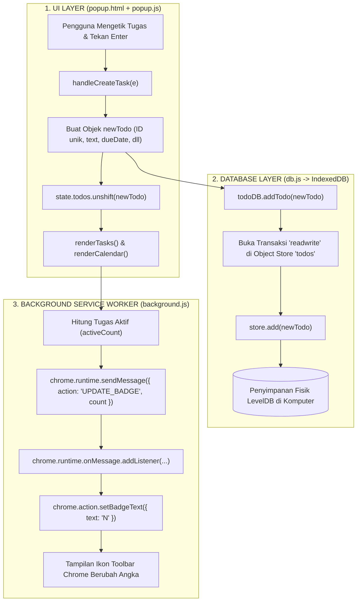
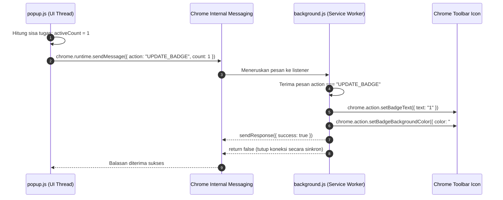

# PANDUAN LENGKAP: BEDAH DETAIL SETIAP KODE & ALUR PENGIRIMAN DATA
## EKSTENSI TO-DO LIST (CHROME MANIFEST V3)

Dokumen ini membedah secara mendalam seluruh kode sumber, siklus pengiriman data (*data flow*), pertukaran pesan antar-komponen (*inter-process communication*), serta mekanisme internal penyimpanan data pada ekstensi **sprespektor**.

---

## DAFTAR ISI
1. [BAB 1: Peta Arsitektur & Siklus Pengiriman Data (Data Flow)](#bab-1-peta-arsitektur--siklus-pengiriman-data-data-flow)
   - [1.1 Alur Simpan Tugas Baru (Data Ingestion)](#11-alur-simpan-tugas-baru-data-ingestion)
   - [1.2 Alur Membaca & Menampilkan Data (Data Retrieval & Render)](#12-alur-membaca--menampilkan-data-data-retrieval--render)
   - [1.3 Alur Edit Tugas & Ubah Status Centang (Data Mutation)](#13-alur-edit-tugas--ubah-status-centang-data-mutation)
   - [1.4 Alur Pengiriman Pesan Lencana Toolbar (Inter-Process Messaging)](#14-alur-pengiriman-pesan-lencana-toolbar-inter-process-messaging)
2. [BAB 2: Bedah Detail Kode `manifest.json`](#bab-2-bedah-detail-kode-manifestjson)
3. [BAB 3: Bedah Detail Kode `background.js` (Service Worker)](#bab-3-bedah-detail-kode-backgroundjs-service-worker)
4. [BAB 4: Bedah Detail Kode `db.js` (IndexedDB Wrapper Engine)](#bab-4-bedah-detail-kode-dbjs-indexeddb-wrapper-engine)
5. [BAB 5: Bedah Detail Kode `popup.html` (Antarmuka Pengguna)](#bab-5-bedah-detail-kode-popuphtml-antarmuka-pengguna)
6. [BAB 6: Bedah Detail Kode `popup.css` (Sistem Styling & Animasi)](#bab-6-bedah-detail-kode-popupcss-sistem-styling--animasi)
7. [BAB 7: Bedah Detail Kode `popup.js` (Logika & Controller)](#bab-7-bedah-detail-kode-popupjs-logika--controller)
8. [BAB 8: Ringkasan & Tabel Hubungan Antar-Kode](#bab-8-ringkasan--tabel-hubungan-antar-kode)

---

## BAB 1: Peta Arsitektur & Siklus Pengiriman Data (Data Flow)

Dalam arsitektur Manifest V3, ekstensi terbagi menjadi beberapa lingkungan (*execution environments*) yang terisolasi. Aplikasi ini memiliki 3 aktor utama:
1. **UI Layer (`popup.html`, `popup.css`, `popup.js`)**: Berjalan saat jendela popup dibuka oleh pengguna.
2. **Database Layer (`db.js` -> IndexedDB)**: Berjalan di origin aman `chrome-extension://<ID>/` yang menulis langsung ke disk fisik komputer.
3. **Background Layer (`background.js`)**: Service worker yang mengontrol badge di ikon toolbar Chrome.



---

### 1.1 Alur Simpan Tugas Baru (Data Ingestion)
1. **Pengguna Memasukkan Teks:** Pengguna mengetik nama tugas di `#task-title-input` dan memilih tanggal di Shadcn Datepicker (nilai tanggal disimpan di input tersembunyi `#task-date-picker`).
2. **Event Trigger:** Form memicu event `submit` yang ditangkap fungsi `handleCreateTask(e)` di [`popup.js`](file:///home/splev/Projects/UKK/popup.js).
3. **Konstruksi Objek:** Dibuat objek tugas JavaScript:
   ```javascript
   const newTodo = {
     id: "todo_" + Date.now() + "_" + Math.random().toString(36).substr(2, 5),
     text: val,
     dueDate: dateVal, // format YYYY-MM-DD
     completed: false,
     createdAt: Date.now(),
     updatedAt: Date.now()
   };
   ```
4. **Pengiriman ke Database (`db.js`):**
   * Dipanggil fungsi `await todoDB.addTodo(newTodo)`.
   * Di dalam [`db.js`](file:///home/splev/Projects/UKK/db.js), dibuka transaksi `readwrite` ke store `todos`.
   * Browser mengeksekusi operasi `store.add(todoItem)`.
   * Data diubah menjadi record biner dan disimpan ke disk lokal komputer.
5. **Pembaruan Tampilan (DOM Render):**
   * `state.todos.unshift(newTodo)` meletakkan tugas baru di urutan paling atas.
   * `renderTasks()` merender elemen `<li>` baru ke dalam daftar.
   * `updateSummaryStats()` menghitung ulang tugas aktif dan mengirim pesan ke `background.js` untuk memperbarui lencana toolbar.

---

### 1.2 Alur Membaca & Menampilkan Data (Data Retrieval & Render)
Ketika ikon ekstensi diklik, popup dibuat ulang (*fresh instance*):
1. File [`popup.js`](file:///home/splev/Projects/UKK/popup.js) otomatis mengeksekusi `loadInitialData()`.
2. Dipanggil `await todoDB.getAllTodos()` pada [`db.js`](file:///home/splev/Projects/UKK/db.js).
3. `db.js` membuka transaksi `"readonly"` ke store `todos` dan menjalankan `store.getAll()`.
4. Jika database kosong (pertama kali dipasang), diinjeksikan 2 data tugas awal (`seedTodos`). Jika sudah ada, seluruh array data dikembalikan ke `state.todos`.
5. Fungsi `renderTasks()` membaca `state.todos`, menyaring berdasarkan filter aktif (`all`, `active`, atau `completed`), membuat elemen HTML secara dinamis, dan menempelkannya ke DOM `#task-list-ul`.
6. Fungsi `renderCalendar()` menyaring tugas yang memiliki tanggal sama dengan minggu yang dipilih, lalu menampilkan titik-titik indikator agenda.

---

### 1.3 Alur Edit Tugas & Ubah Status Centang (Data Mutation)
1. **Centang Tugas (Toggle Completed):**
   * Checkbox di-klik ➔ memanggil `toggleTodoStatus(id)`.
   * Nilai `todo.completed` dibalik (`true` ➔ `false` atau sebaliknya).
   * Dipanggil `await todoDB.updateTodo(todo)`.
   * `db.js` menjalankan `store.put(todoItem)`. Metode `put` secara otomatis memperbarui record yang memiliki `id` tersebut.
   * UI dan badge toolbar langsung diperbarui secara otomatis.
2. **Edit Teks Tugas (Inline Quick Edit):**
   * Pengguna mengklik tombol pensil (`✎`) atau klik ganda (*double-click*) pada teks tugas.
   * `state.editingTaskId` diisi dengan ID tugas terkait.
   * `renderTasks()` merender baris tersebut sebagai `<form class="task-edit-form">` berisi input teks.
   * Saat tombol centang `✓` atau tombol **Enter** ditekan, fungsi `saveEditTask(id, newText)` dijalankan:
     - Teks baru disimpan ke IndexedDB melalui `todoDB.updateTodo(todo)`.
     - `state.editingTaskId` dikembalikan ke `null`.
     - Tampilan kembali normal dengan teks tugas yang sudah diperbarui.

---

### 1.4 Alur Pengiriman Pesan Lencana Toolbar (Inter-Process Messaging)
Karena UI popup dan toolbar browser berada di thread yang berbeda, komunikasi dilakukan melalui pesan internal Chrome (*message passing*):



---

## BAB 2: Bedah Detail Kode `manifest.json`

File [`manifest.json`](file:///home/splev/Projects/UKK/manifest.json) adalah berkas deklarasi identitas, perizinan, dan entri program bagi browser.

```json
{
  "manifest_version": 3,
  "name": "sprespektor",
  "version": "1.0.0",
  "description": "sprespektor - Ekstensi To-Do List minimalis, cepat, dan modern berbasis IndexedDB dengan Shadcn/ui Date Picker.",
  "permissions": [
    "storage"
  ],
  "background": {
    "service_worker": "background.js"
  },
  "action": {
    "default_title": "sprespektor",
    "default_popup": "popup.html",
    "default_icon": {
      "16": "icons/icon16.png",
      "48": "icons/icon48.png",
      "128": "icons/icon128.png"
    }
  },
  "icons": {
    "16": "icons/icon16.png",
    "48": "icons/icon48.png",
    "128": "icons/icon128.png"
  }
}
```

### Penjelasan Setiap Baris:
* **Baris 2 (`"manifest_version": 3`)**: Mewajibkan standar Chromium Manifest V3 terbaru yang lebih aman, hemat baterai, dan menolak injeksi kode asing dari luar (*CSP strict*).
* **Baris 3-5 (`name`, `version`, `description`)**: Metadata yang dibaca oleh Chrome Web Store dan halaman manajemen ekstensi (`chrome://extensions`).
* **Baris 6-8 (`"permissions": ["storage"]`)**: Memberikan hak akses kepada ekstensi untuk menggunakan API penyimpanan peramban.
* **Baris 9-11 (`"background": { "service_worker": "background.js" }`)**: Menentukan berkas `background.js` sebagai service worker yang bekerja di latar belakang secara *event-driven* (hidup saat ada event, tidur saat idle).
* **Baris 12-20 (`"action": { ... }`)**:
  * `"default_title"`: Teks *tooltip* yang muncul saat kursor mouse melayang di atas ikon ekstensi di toolbar.
  * `"default_popup": "popup.html"`: **Sangat penting**. Baris ini memerintahkan Chrome untuk membuka jendela popup `popup.html` ketika pengguna mengklik ikon toolbar, sehingga tidak memerlukan injeksi skrip ke halaman web luar dan bebas dari batasan URL `chrome://`.
  * `"default_icon"`: Gambar ikon toolbar pada ukuran 16px, 48px, dan 128px.
* **Baris 21-25 (`"icons"`)**: Ikon resmi yang digunakan di halaman pengelolaan ekstensi dan sistem operasi.

---

## BAB 3: Bedah Detail Kode `background.js` (Service Worker)

File [`background.js`](file:///home/splev/Projects/UKK/background.js) bertindak sebagai pengendali lencana (*badge*) ikon ekstensi.

```javascript
/**
 * Background Service Worker (Manifest V3)
 * Bertanggung jawab mengelola badge counter dan inisialisasi ekstensi
 */

// Listener untuk pesan pembaruan badge counter dari popup
chrome.runtime.onMessage.addListener((message, sender, sendResponse) => {
  if (message && message.action === "UPDATE_BADGE") {
    const count = typeof message.count === "number" ? message.count : 0;
    const badgeText = count > 0 ? String(count) : "";

    chrome.action.setBadgeText({ text: badgeText });
    chrome.action.setBadgeBackgroundColor({ color: "#2563eb" });
    sendResponse({ success: true });
    return false; // Respons sinkron, tutup port pesan segera
  }
  return false;
});

// Inisialisasi saat ekstensi pertama kali di-install
chrome.runtime.onInstalled.addListener(() => {
  chrome.action.setBadgeText({ text: "" });
});
```

### Penjelasan Setiap Blok & Baris:
* **Baris 7 (`chrome.runtime.onMessage.addListener(...)`)**: Mendaftarkan saluran pendengar pesan internal. Menerima tiga parameter:
  - `message`: Objek payload yang dikirim (misal: `{ action: "UPDATE_BADGE", count: 2 }`).
  - `sender`: Informasi siapa yang mengirim pesan (popup, tab, atau skrip lain).
  - `sendResponse`: Fungsi callback untuk membalas ke pengirim pesan.
* **Baris 8 (`if (message && message.action === "UPDATE_BADGE")`)**: Memvalidasi aksi agar service worker hanya merespons pesan yang relevan.
* **Baris 9-10 (`const badgeText = count > 0 ? String(count) : "";`)**: Memastikan jika tidak ada tugas yang tersisa (`count === 0`), teks badge dikosongkan agar ikon toolbar tetap bersih.
* **Baris 12 (`chrome.action.setBadgeText(...)`)**: Mengubah angka teks pada kotak lencana di ikon toolbar.
* **Baris 13 (`chrome.action.setBadgeBackgroundColor({ color: "#2563eb" })`)**: Memberi warna biru (#2563eb) pada background lencana.
* **Baris 14 (`sendResponse({ success: true })`)**: Mengirim konfirmasi balik bahwa perubahan berhasil dieksekusi.
* **Baris 15 (`return false;`)**: **Bagian Krusial**. Mengembalikan `false` menandakan respons diberikan secara sinkron sehingga port perpesanan langsung ditutup secara rapi. Jika dikembalikan `true`, Chrome akan menggantung koneksi dan memicu error `The message port closed before a response was received`.
* **Baris 21-23 (`chrome.runtime.onInstalled.addListener(...)`)**: Dipanggil satu kali saat ekstensi pertama kali dipasang atau diperbarui, memastikan badge di-reset menjadi kosong.

---

## BAB 4: Bedah Detail Kode `db.js` (IndexedDB Wrapper Engine)

File [`db.js`](file:///home/splev/Projects/UKK/db.js) adalah jantung dari persistensi data. Ia membungkus API IndexedDB yang berbasis event menjadi `Promise` murni sehingga mudah dipanggil dengan sintaks modern `async/await`.

### 4.1 Konstruktor & Inisialisasi Skema (`init`)
```javascript
class TodoDatabase {
  constructor() {
    this.dbName = "TodoAppDB";
    this.dbVersion = 1;
    this.db = null;
  }

  async init() {
    if (this.db) return this.db;

    return new Promise((resolve, reject) => {
      const request = indexedDB.open(this.dbName, this.dbVersion);

      request.onupgradeneeded = (event) => {
        const db = event.target.result;

        // 1. Buat Object Store 'todos' jika belum ada
        if (!db.objectStoreNames.contains("todos")) {
          const todoStore = db.createObjectStore("todos", { keyPath: "id" });
          todoStore.createIndex("idx_dueDate", "dueDate", { unique: false });
          todoStore.createIndex("idx_completed", "completed", { unique: false });
          todoStore.createIndex("idx_createdAt", "createdAt", { unique: false });
        }

        // 2. Buat Object Store 'settings' jika belum ada
        if (!db.objectStoreNames.contains("settings")) {
          db.createObjectStore("settings", { keyPath: "key" });
        }
      };

      request.onsuccess = (event) => {
        this.db = event.target.result;
        resolve(this.db);
      };

      request.onerror = (event) => {
        console.error("Gagal membuka IndexedDB:", event.target.error);
        reject(event.target.error);
      };
    });
  }
```

#### Analisis:
* `this.dbName = "TodoAppDB"`: Nama ruang penyimpanan database di profil Chrome.
* `this.dbVersion = 1`: Versi skema. Setiap kali ada penambahan tabel atau indeks baru di masa mendatang, angka ini cukup dinaikkan ke `2`.
* `indexedDB.open(this.dbName, this.dbVersion)`: Meminta browser membuka database.
* `request.onupgradeneeded`: Event khusus yang **hanya berjalan saat database pertama kali dibuat** atau versinya bertambah:
  - `db.createObjectStore("todos", { keyPath: "id" })`: Membuat tabel `todos` dengan `id` sebagai *Primary Key*.
  - `createIndex("idx_dueDate", "dueDate")`: Membuat indeks tanggal agar pencarian tugas berdasarkan tanggal di kalender berjalan secepat kilat ($O(\log n)$) tanpa perlu memeriksa data satu per satu.
  - `createIndex("idx_completed", "completed")`: Mengindeks status selesai untuk pemfilteran cepat.
* `request.onsuccess`: Berhasil terhubung, menyimpan instance `db`, dan me-resolve Promise.

### 4.2 Operasi CRUD (Create, Read, Update, Delete)
```javascript
  // MENGAMBIL SELURUH DATA TUGAS
  async getAllTodos() {
    await this.init();
    return new Promise((resolve, reject) => {
      const tx = this.db.transaction("todos", "readonly");
      const store = tx.objectStore("todos");
      const request = store.getAll();

      request.onsuccess = () => resolve(request.result || []);
      request.onerror = () => reject(request.error);
    });
  }

  // MENAMBAHKAN TUGAS BARU
  async addTodo(todoItem) {
    await this.init();
    return new Promise((resolve, reject) => {
      const tx = this.db.transaction("todos", "readwrite");
      const store = tx.objectStore("todos");
      const request = store.add(todoItem);

      request.onsuccess = () => resolve(request.result);
      request.onerror = () => reject(request.error);
    });
  }

  // MEMPERBARUI TUGAS (EDIT / TOGGLE STATUS)
  async updateTodo(todoItem) {
    await this.init();
    return new Promise((resolve, reject) => {
      const tx = this.db.transaction("todos", "readwrite");
      const store = tx.objectStore("todos");
      const request = store.put(todoItem);

      request.onsuccess = () => resolve(request.result);
      request.onerror = () => reject(request.error);
    });
  }

  // MENGHAPUS SATU TUGAS
  async deleteTodo(id) {
    await this.init();
    return new Promise((resolve, reject) => {
      const tx = this.db.transaction("todos", "readwrite");
      const store = tx.objectStore("todos");
      const request = store.delete(id);

      request.onsuccess = () => resolve(true);
      request.onerror = () => reject(request.error);
    });
  }

  // MENGHAPUS SEMUA TUGAS SELESAI SECARA BATCH (ATOMIC)
  async deleteCompletedTodos() {
    await this.init();
    const all = await this.getAllTodos();
    const completedIds = all.filter(t => t.completed).map(t => t.id);

    return new Promise((resolve, reject) => {
      const tx = this.db.transaction("todos", "readwrite");
      const store = tx.objectStore("todos");

      completedIds.forEach(id => store.delete(id));

      tx.oncomplete = () => resolve(completedIds.length);
      tx.onerror = () => reject(tx.error);
    });
  }
```

#### Analisis:
* **`store.add` vs `store.put`**: `add` menolak jika ID sudah ada (melindungi integritas data), sedangkan `put` berfungsi sebagai *upsert* (memperbarui bila sudah ada, menambah bila belum).
* **`tx.oncomplete` pada `deleteCompletedTodos`**: Seluruh tugas selesai dihapus dalam **satu transaksi tunggal**. Jika di tengah jalan browser ditutup mendadak, data tidak akan korup karena sifat atomik dari transaksi IndexedDB.

---

## BAB 5: Bedah Detail Kode `popup.html` (Antarmuka Pengguna)

File [`popup.html`](file:///home/splev/Projects/UKK/popup.html) menyediakan struktur DOM yang dibagi ke dalam 4 bagian utama:

```html
<!DOCTYPE html>
<html lang="id">
<head>
  <meta charset="UTF-8">
  <meta name="viewport" content="width=device-width, initial-scale=1.0">
  <title>To-Do List</title>
  <link rel="stylesheet" href="popup.css">
</head>
<body>
  <div class="todo-popup-card">
    <!-- 1. HEADER (DUAL TABS & TOMBOL "+") -->
    <header class="widget-header">
      <nav class="nav-tabs" role="tablist">
        <button type="button" class="tab-btn active" id="btn-tab-task">
          <span>Task</span>
          <span class="tab-count-badge" id="badge-tab-count">0</span>
        </button>
        <button type="button" class="tab-btn" id="btn-tab-calender">
          <span>Calender</span>
        </button>
      </nav>
      <button type="button" class="btn-toggle-add" id="btn-toggle-add" title="Tambah tugas baru (+)">+</button>
    </header>

    <!-- 2. EXPANDABLE DRAWER INPUT FORM -->
    <section class="expandable-drawer" id="expandable-drawer">
      <form id="add-task-form">
        <div class="input-row">
          <input 
            type="text" 
            id="task-title-input" 
            placeholder="Tulis tugas baru lalu tekan Enter..." 
            autocomplete="off" 
          />
          <span class="badge-hint-enter">↵ Enter</span>
        </div>

        <!-- KOMPONEN SHADCN/UI DATE PICKER -->
        <div class="shadcn-datepicker-wrap" id="shadcn-datepicker-wrap">
          <button type="button" class="shadcn-date-trigger" id="shadcn-date-trigger">
            <!-- Ikon Kalender SVG -->
            <span id="shadcn-trigger-label">Hari ini, 10 Nov</span>
            <span class="shadcn-relative-badge" id="shadcn-rel-badge">Hari ini</span>
          </button>
          <input type="hidden" id="task-date-picker" />

          <!-- FLOATING POPOVER KALENDER -->
          <div class="shadcn-popover" id="shadcn-popover" style="display: none;">
            <div class="shadcn-popover-header">
              <button type="button" class="shadcn-nav-arrow" id="shadcn-btn-prev">‹</button>
              <span class="shadcn-month-title" id="shadcn-month-title">November 2026</span>
              <button type="button" class="shadcn-nav-arrow" id="shadcn-btn-next">›</button>
            </div>
            <div class="shadcn-weekdays-row">
              <span>Min</span><span>Sen</span><span>Sel</span><span>Rab</span><span>Kam</span><span>Jum</span><span>Sab</span>
            </div>
            <div class="shadcn-days-grid" id="shadcn-days-grid"></div>
            <div class="shadcn-presets-row">
              <button type="button" class="shadcn-chip" id="shadcn-preset-today">Hari ini</button>
              <button type="button" class="shadcn-chip" id="shadcn-preset-tomorrow">Besok</button>
              <button type="button" class="shadcn-chip" id="shadcn-preset-nextweek">+7 Hari</button>
            </div>
          </div>
        </div>
      </form>
    </section>

    <!-- 3. TAB VIEW: TASK -->
    <div id="panel-task-view">
      <nav class="filter-bar">
        <button type="button" class="chip-btn active" data-filter="all">Semua</button>
        <button type="button" class="chip-btn" data-filter="active">Aktif</button>
        <button type="button" class="chip-btn" data-filter="completed">Selesai</button>
      </nav>
      <main class="task-scroll-container">
        <ul class="task-list" id="task-list-ul"></ul>
        <div class="empty-state-box" id="empty-state-view" style="display:none;">
          <div class="empty-state-icon">📝</div>
          <p class="empty-state-text">Tidak ada tugas pada filter ini.</p>
        </div>
      </main>
      <footer class="widget-footer">
        <span id="footer-summary-text">0 tugas tersisa</span>
        <button type="button" class="btn-clear-done" id="btn-clear-done">Hapus selesai</button>
      </footer>
    </div>

    <!-- 4. TAB VIEW: CALENDER -->
    <div id="panel-calender-view" class="calender-panel" style="display:none;">
      <div class="calender-header-meta">
        <span class="cal-month-title" id="cal-month-title">November 2026</span>
        <div class="cal-nav-buttons">
          <button type="button" class="btn-cal-nav" id="btn-cal-prev">◀</button>
          <button type="button" class="btn-cal-nav" id="btn-cal-today-shortcut">Hari Ini</button>
          <button type="button" class="btn-cal-nav" id="btn-cal-next">▶</button>
        </div>
      </div>
      <div class="cal-week-grid" id="cal-week-grid"></div>
      <div class="agenda-section-title">
        <span id="agenda-date-heading">Agenda</span>
        <span class="agenda-count-badge" id="agenda-count-heading">0 tugas</span>
      </div>
      <div class="agenda-cards-list" id="cal-agenda-list"></div>
    </div>
  </div>

  <script src="db.js"></script>
  <script src="popup.js"></script>
</body>
</html>
```

### Penjelasan Setiap Bagian:
1. **`<div class="todo-popup-card">`**: Wadah utama pembungkus seluruh aplikasi berdimensi tepat 360px dengan bayangan (*box-shadow*) modern.
2. **Tab Header & Tombol `+` (`#btn-toggle-add`)**: Navigasi tab ganda yang membedakan tampilan daftar tugas umum (*Task View*) dan tampilan mingguan (*Calender View*). Tombol `+` membuka laci input formulir.
3. **Formulir Laci (`#expandable-drawer`)**: Form yang dapat meluncur membuka dan menutup secara mulus menggunakan transisi CSS.
4. **Shadcn/UI Date Picker (`#shadcn-datepicker-wrap`)**: Komponen kalender mengambang (*popover*) yang menampilkan nama bulan, tombol navigasi panah, grid hari, dan tombol cepat (*presets*).
5. **Panel Task (`#panel-task-view`)**: Memuat tombol filter pill (*Semua, Aktif, Selesai*), wadah scrollable `#task-list-ul`, dan footer status sisa tugas.
6. **Panel Calender (`#panel-calender-view`)**: Memuat navigasi minggu, grid 7 hari interaktif, dan daftar agenda untuk tanggal yang sedang diklik.
7. **Pemuatan Skrip di Akhir (`db.js` lalu `popup.js`)**: `db.js` wajib dimuat lebih dulu agar kelas `TodoDatabase` sudah tersedia saat `popup.js` diinisialisasi.

---

## BAB 6: Bedah Detail Kode `popup.css` (Sistem Styling & Animasi)

File [`popup.css`](file:///home/splev/Projects/UKK/popup.css) menerapkan arsitektur CSS bersih bertema *Light Minimalist Modern*.

### 6.1 Desain Variabel & Dimensi Window
```css
:root {
  --bg-primary: #ffffff;
  --bg-secondary: #f8fafc;
  --text-main: #0f172a;
  --text-muted: #64748b;
  --border-color: #e2e8f0;
  --accent-blue: #2563eb;
  --accent-hover: #1d4ed8;
  --danger-color: #ef4444;
  --radius-sm: 6px;
  --radius-md: 10px;
  --radius-full: 9999px;
  --shadow-popup: 0 10px 25px -5px rgba(0, 0, 0, 0.08), 0 8px 10px -6px rgba(0, 0, 0, 0.04);
}

body {
  margin: 0;
  padding: 0;
  width: 360px;
  min-height: 480px;
  max-height: 560px;
  overflow: hidden;
  font-family: -apple-system, BlinkMacSystemFont, "Segoe UI", Roboto, Helvetica, Arial, sans-serif;
  background-color: var(--bg-primary);
  color: var(--text-main);
}
```
* Mengunci lebar jendela pada **360px** dan batas tinggi maksimal **560px** agar ukuran popup pas dengan proporsi toolbar Chrome.

### 6.2 Checkbox Bulat Kustom (*Circular Checkbox*)
```css
.circle-checkbox-wrapper {
  position: relative;
  display: inline-flex;
  align-items: center;
  cursor: pointer;
}
.circle-checkbox-wrapper input[type="checkbox"] {
  position: absolute;
  opacity: 0;
  cursor: pointer;
}
.circle-checkbox-custom {
  width: 18px;
  height: 18px;
  border: 1.5px solid #cbd5e1;
  border-radius: 50%;
  transition: all 0.15s ease-in-out;
}
.circle-checkbox-wrapper input[type="checkbox"]:checked + .circle-checkbox-custom {
  background-color: var(--accent-blue);
  border-color: var(--accent-blue);
  background-image: url("data:image/svg+xml,..."); /* Ikon centang SVG putih */
  background-repeat: no-repeat;
  background-position: center;
}
```
* Kotak centang asli browser disembunyikan dengan `opacity: 0`, dan digantikan dengan elemen bulat `.circle-checkbox-custom` yang menampilkan tanda centang putih halus saat aktif.

### 6.3 Tombol Aksi Hover (Edit & Hapus)
```css
.task-action-btns {
  display: flex;
  align-items: center;
  gap: 4px;
  opacity: 0;
  transition: opacity 0.15s ease;
}
.task-item:hover .task-action-btns {
  opacity: 1; /* Hanya muncul saat kursor melayang di atas baris tugas */
}
.btn-edit-task, .btn-delete-task {
  background: none;
  border: none;
  cursor: pointer;
  padding: 3px 5px;
  border-radius: 4px;
  color: #94a3b8;
  font-size: 13px;
  transition: all 0.15s;
}
.btn-edit-task:hover {
  color: var(--accent-blue);
  background-color: #eff6ff;
}
.btn-delete-task:hover {
  color: var(--danger-color);
  background-color: #fef2f2;
}
```

---

## BAB 7: Bedah Detail Kode `popup.js` (Logika & Controller)

File [`popup.js`](file:///home/splev/Projects/UKK/popup.js) menghubungkan antarmuka pengguna dengan basis data. Berikut adalah bedah modul-modul intinya:

### 7.1 State Management & Tanggal Hari Ini
```javascript
(function () {
  const DAY_MS = 24 * 60 * 60 * 1000;
  const todoDB = new TodoDatabase();

  function toISODateString(dateObj) {
    const y = dateObj.getFullYear();
    const m = String(dateObj.getMonth() + 1).padStart(2, "0");
    const d = String(dateObj.getDate()).padStart(2, "0");
    return `${y}-${m}-${d}`;
  }

  const todayDateStr = toISODateString(new Date());

  let state = {
    todos: [],
    currentFilter: "all",
    currentTab: "task",
    isInputExpanded: false,
    editingTaskId: null,
    calSelectedDate: todayDateStr,
    calWeekOffset: 0
  };
```
* Dibungkus dalam IIFE `(function() { ... })()` agar variabel tidak bocor ke scope global.
* `toISODateString`: Mengubah objek JavaScript `Date` menjadi format standar ISO `YYYY-MM-DD` (misal: `"2026-11-12"`).
* `state`: Sumber kebenaran tunggal (*single source of truth*) yang merekam kondisi UI saat ini.

### 7.2 Algoritma Hitung Badge Hari Relatif
```javascript
function calculateRelativeBadge(dateStr, isCompleted) {
  if (isCompleted) {
    return { label: "Selesai", cls: "rel-completed" };
  }
  if (!dateStr) {
    return { label: "Hari ini", cls: "rel-today" };
  }

  const targetDate = parseISODateString(dateStr);
  const todayDate = parseISODateString(todayDateStr);
  const diffDays = Math.round((targetDate.getTime() - todayDate.getTime()) / DAY_MS);

  if (diffDays === 0) {
    return { label: "Hari ini", cls: "rel-today" };
  } else if (diffDays === 1) {
    return { label: "Besok", cls: "rel-tomorrow" };
  } else if (diffDays > 1) {
    return { label: `+${diffDays} hr`, cls: "rel-future" };
  } else {
    // Selisih negatif = Tugas terlambat
    return { label: `${diffDays} hr`, cls: "rel-overdue" };
  }
}
```
* Menghasilkan label cerdas seperti **Hari ini**, **Besok**, **+3 hr** (untuk 3 hari ke depan), atau **-2 hr** (tugas yang sudah terlambat 2 hari) secara otomatis.

### 7.3 Logika Komponen Shadcn Date Picker
```javascript
function renderShadcnPopoverGrid() {
  shadcnDaysGrid.innerHTML = "";
  const viewYear = popoverViewDate.getFullYear();
  const viewMonth = popoverViewDate.getMonth();
  
  const firstDay = new Date(viewYear, viewMonth, 1).getDay();
  const daysInMonth = new Date(viewYear, viewMonth + 1, 0).getDate();
  const daysInPrevMonth = new Date(viewYear, viewMonth, 0).getDate();

  // 1. Padding hari bulan sebelumnya
  for (let p = firstDay - 1; p >= 0; p--) {
    const cell = document.createElement("button");
    cell.className = "shadcn-day-cell outside";
    cell.textContent = String(daysInPrevMonth - p);
    shadcnDaysGrid.appendChild(cell);
  }

  // 2. Hari-hari dalam bulan aktif
  for (let day = 1; day <= daysInMonth; day++) {
    const cell = document.createElement("button");
    const iso = `${viewYear}-${String(viewMonth + 1).padStart(2, "0")}-${String(day).padStart(2, "0")}`;
    const isToday = iso === todayDateStr;
    const isSelected = iso === taskDatePicker.value;

    cell.className = `shadcn-day-cell ${isToday ? "today" : ""} ${isSelected ? "selected" : ""}`;
    cell.textContent = String(day);
    cell.addEventListener("click", (e) => {
      e.stopPropagation();
      setPickedDate(iso);
      closeShadcnPopover();
    });
    shadcnDaysGrid.appendChild(cell);
  }
}
```
* Menghitung tata letak kalender bulanan secara akurat, menandai hari ini dengan lingkaran biru muda dan hari yang dipilih dengan warna biru pekat.

### 7.4 Logika Edit Tugas Inline
```javascript
// Jika item sedang dalam mode edit inline:
if (state.editingTaskId === todo.id) {
  li.classList.add("is-editing");
  const editForm = document.createElement("form");
  const editInput = document.createElement("input");
  editInput.value = todo.text;

  editForm.addEventListener("submit", async (e) => {
    e.preventDefault();
    await saveEditTask(todo.id, editInput.value.trim());
  });

  // Tombol Simpan & Batal
  const btnSave = document.createElement("button");
  btnSave.innerHTML = "✓";
  const btnCancel = document.createElement("button");
  btnCancel.innerHTML = "✕";
  btnCancel.addEventListener("click", () => {
    state.editingTaskId = null;
    renderTasks();
  });
}
```
* Memungkinkan pengguna mengubah judul tugas tanpa perlu membuka dialog modal tambahan.

---

## BAB 8: Ringkasan & Tabel Hubungan Antar-Kode

| Nama File | Tipe Komponen | Peran Utama | Berinteraksi Dengan |
| :--- | :--- | :--- | :--- |
| [`manifest.json`](file:///home/splev/Projects/UKK/manifest.json) | Konfigurasi | Mendaftarkan ekstensi, permission, dan popup | Browser Chrome Core |
| [`background.js`](file:///home/splev/Projects/UKK/background.js) | Service Worker | Mengatur angka badge lencana toolbar | `popup.js` via `chrome.runtime` |
| [`db.js`](file:///home/splev/Projects/UKK/db.js) | Database Engine | Menyimpan data ke IndexedDB secara asinkron | `popup.js` & IndexedDB Browser |
| [`popup.html`](file:///home/splev/Projects/UKK/popup.html) | Tampilan (DOM) | Menyusun tata letak visual UI | `popup.css` & `popup.js` |
| [`popup.css`](file:///home/splev/Projects/UKK/popup.css) | Desain Gaya | Memberikan tampilan Light Minimalist Modern | `popup.html` |
| [`popup.js`](file:///home/splev/Projects/UKK/popup.js) | Pengendali (Controller) | Mengatur event, state, kalender, dan rendering | `popup.html`, `db.js`, `background.js` |

Dengan struktur di atas, aplikasi memiliki arsitektur yang sangat modular (*Separation of Concerns*): UI terpisah dari basis data, dan komunikasi lintas proses berjalan aman melalui API resmi Chrome.
