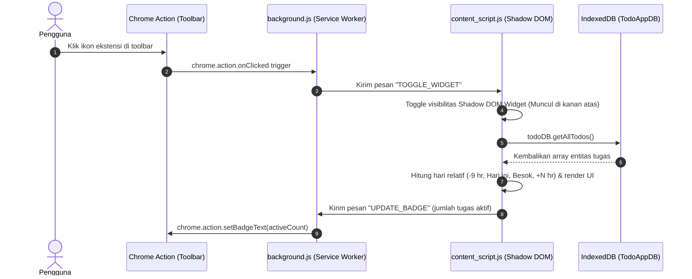

# Arsitektur Sistem: Overlay Drawer To-Do List Extension (Manifest V3)

## 1. Ringkasan Ekstensi
Ekstensi browser Chrome berbasis **Manifest V3** untuk mencatat tugas (To-Do List) secara instan melalui panel samping overlay (*drawer*) yang melayang dan menimpa tampilan tab aktif tanpa mengalihkan fokus pengguna dari halaman web.

## 2. Tech Stack & Standar Rekayasa
- **Platform:** Chrome Extension Manifest V3 (MV3).
- **Core Technology:** Vanilla JavaScript (ES6+), Modern Semantic HTML5, CSS3 Custom Properties.
- **Framework & Bundler:** Murni tanpa bundler (Zero-dependency / no Webpack / no Vite).
- **DOM Encapsulation:** Native **Shadow DOM** (`Element.attachShadow({ mode: 'open' })`) untuk mengisolasi seluruh elemen dan stylesheet ekstensi agar tidak bentrok dengan CSS host page (seperti Bootstrap, Tailwind, atau global CSS reset).
- **Data Persistence:** `chrome.storage.local` API dengan serialisasi JSON aman dan validasi skema.
- **Security & CSP:** 100% bebas dari inline script (`<script>` inline atau atribut `onclick`). Seluruh event handler di-bind via `addEventListener`.
- **Kompatibilitas:** Didukung pada Chrome versi 114+ di semua OS (Linux, macOS, Windows).

---

## 3. Peta Indeks & Struktur File Project

```
/home/splev/Projects/UKK/
├── manifest.json              # Definisi Manifest V3 (permissions, action, content script, web_accessible_resources)
├── background.js              # Service Worker pengatur toggle event toolbar dan badge text
├── db.js                      # Modul Promise-based IndexedDB Manager (TodoAppDB)
├── content_script.js          # Injeksi drawer ke host page menggunakan Shadow DOM & penanganan state
├── widget.css                 # Stylesheet terisolasi untuk widget Shadow DOM (Light Minimalist)
├── icons/                     # Icon ekstensi resmi Chrome
│   ├── icon16.png
│   ├── icon48.png
│   └── icon128.png
├── todo-extension-doc/        # Dokumentasi Wajib Sistem
│   ├── architecture.md        # File ini: Arsitektur, tech stack, dan peta file
│   ├── frontend.md            # Rancangan UI/UX, komponen, state, dan interaksi
│   ├── backend.md             # IndexedDB schema, lifecycle CRUD, runtime messaging
│   ├── changelog.md           # Histori perubahan, penambahan, dan revisi
│   └── prototypes-preview.html# Showcase interaktif prototipe browser
```

---

## 4. Alur Kerja Sistem (System Data Flow)


