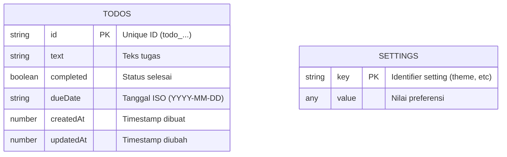

# Rancangan Back-End & Data Storage: Overlay To-Do List

## 1. Background Service Worker (`background.js`)

Pada arsitektur Chrome Extension Manifest V3, background berjalan secara *event-driven* (service worker). Tanggung jawab utama service worker dalam sistem ini meliputi:
1. **Action Click Handler:** Menerima klik pada ikon ekstensi di toolbar browser dan mengirimkan pesan `TOGGLE_DRAWER` ke tab web yang sedang aktif.
2. **Badge Counter Manager:** Mengelola teks badge (`chrome.action.setBadgeText`) dan warna latar badge (`chrome.action.setBadgeBackgroundColor`) agar menampilkan jumlah tugas aktif yang belum selesai.
3. **Storage Listener:** Mendengarkan perubahan data di `chrome.storage.onChanged` sehingga jika ada tab lain yang memperbarui daftar tugas, badge toolbar dan panel di tab aktif langsung ter-update secara real-time.

---

## 2. Arsitektur & Skema Database: IndexedDB (`TodoAppDB`)

Sesuai keputusan desain, sistem tidak menggunakan `localStorage` / `chrome.storage.local`, melainkan menggunakan **`IndexedDB`** — mesin database NoSQL transaksional bawaan peramban (*native transactional browser database*).

### 2.1. Parameter Utama Database
- **Nama Database (`DB_NAME`):** `"TodoAppDB"`
- **Versi Database (`DB_VERSION`):** `1`
- **Mekanisme Akses:** Dibungkus dalam modul `IDBManager` berbasis `async/await` (*Promise-based*).

---

### 2.2. Object Stores & Indeks Pencarian

Database terdiri dari 2 *Object Stores* utama:



#### A. Object Store: `todos`
Tempat seluruh rekaman data tugas disimpan.
- **Primary Key (`keyPath`):** `"id"` (string unik, misal: `"todo_1731110001"`)
- **Indeks Pencarian (Indexes):**
  1. **`idx_dueDate`** (field: `"dueDate"`, `unique: false`):
     - Digunakan untuk pencarian cepat berdasarkan tanggal jatuh tempo atau rentang tanggal (*IDBKeyRange*) untuk tab Kalender dan perhitungan badge hari relatif (`-9 hr`, `Hari ini`, `Besok`, `+N hr`).
  2. **`idx_completed`** (field: `"completed"`, `unique: false`):
     - Mempercepat penyaringan tugas aktif (`false`) versus selesai (`true`).
  3. **`idx_createdAt`** (field: `"createdAt"`, `unique: false`):
     - Digunakan untuk pengurutan kronologis pembuatan tugas.

#### B. Object Store: `settings`
Menyimpan konfigurasi pengguna (tema visual, filter terakhir, dll.).
- **Primary Key (`keyPath`):** `"key"` (string, misal: `"theme"`, `"activeFilter"`)
- **Struktur Baris:** `{ key: string, value: any }`

---

### 2.3. Definisi Struktur Entitas Data (TypeScript Definition)

```typescript
// Entitas Tugas Utama
interface TodoEntity {
  id: string;          // Primary Key (keyPath: "id"), misal: "todo_1731110001"
  text: string;        // Isi teks tugas (sanitized text)
  completed: boolean;  // Status pengerjaan (false = aktif, true = selesai)
  dueDate: string;     // Tanggal jatuh tempo presisi ("YYYY-MM-DD", misal: "2026-11-10")
  createdAt: number;   // Epoch timestamp saat dibuat (Date.now())
  updatedAt: number;   // Epoch timestamp saat diubah
}

// Entitas Pengaturan
interface SettingEntity {
  key: string;         // Primary Key (keyPath: "key"), misal: "theme"
  value: any;          // Nilai (misal: "01", "all")
}
```

---

### 2.4. Contoh Rekaman Data di dalam IndexedDB

Contoh baris di store **`todos`**:
```javascript
// Baris 1: Tugas hari ini
{
  id: "todo_1731220001",
  text: "read the md",
  completed: false,
  dueDate: "2026-11-10",
  createdAt: 1731220001000,
  updatedAt: 1731220001000
}

// Baris 2: Tugas terlewat 9 hari lalu (-9 hr)
{
  id: "todo_1731105000",
  text: "read the md",
  completed: false,
  dueDate: "2026-11-01",
  createdAt: 1731105000000,
  updatedAt: 1731105000000
}

// Baris 3: Tugas selesai di masa mendatang (+3 hr)
{
  id: "todo_1731090000",
  text: "review manifest v3 architecture",
  completed: true,
  dueDate: "2026-11-13",
  createdAt: 1731090000000,
  updatedAt: 1731108000000
}
```

Contoh baris di store **`settings`**:
```javascript
{ key: "theme", value: "01" }
{ key: "lastFilter", value: "all" }
```

---

### 2.5. Implementasi Modul IDB Wrapper (`db.js`)

Untuk memastikan kode tidak terjebak dalam *callback hell*, IndexedDB dibungkus dalam modul Promise:

```javascript
// db.js - Modul Manajemen IndexedDB
class TodoDatabase {
  constructor() {
    this.dbName = "TodoAppDB";
    this.version = 1;
    this.db = null;
  }

  async init() {
    return new Promise((resolve, reject) => {
      const request = indexedDB.open(this.dbName, this.version);

      request.onupgradeneeded = (e) => {
        const db = e.target.result;
        
        // Buat Object Store 'todos' jika belum ada
        if (!db.objectStoreNames.contains("todos")) {
          const todoStore = db.createObjectStore("todos", { keyPath: "id" });
          todoStore.createIndex("idx_dueDate", "dueDate", { unique: false });
          todoStore.createIndex("idx_completed", "completed", { unique: false });
          todoStore.createIndex("idx_createdAt", "createdAt", { unique: false });
        }

        // Buat Object Store 'settings' jika belum ada
        if (!db.objectStoreNames.contains("settings")) {
          db.createObjectStore("settings", { keyPath: "key" });
        }
      };

      request.onsuccess = (e) => {
        this.db = e.target.result;
        resolve(this.db);
      };

      request.onerror = (e) => reject(e.target.error);
    });
  }

  // Operasi CRUD
  async getAllTodos() {
    const tx = this.db.transaction("todos", "readonly");
    const store = tx.objectStore("todos");
    return new Promise((resolve, reject) => {
      const req = store.getAll();
      req.onsuccess = () => resolve(req.result || []);
      req.onerror = () => reject(req.error);
    });
  }

  async addTodo(todoItem) {
    const tx = this.db.transaction("todos", "readwrite");
    const store = tx.objectStore("todos");
    return new Promise((resolve, reject) => {
      const req = store.add(todoItem);
      req.onsuccess = () => resolve(req.result);
      req.onerror = () => reject(req.error);
    });
  }

  async updateTodo(todoItem) {
    const tx = this.db.transaction("todos", "readwrite");
    const store = tx.objectStore("todos");
    return new Promise((resolve, reject) => {
      const req = store.put(todoItem);
      req.onsuccess = () => resolve(req.result);
      req.onerror = () => reject(req.error);
    });
  }

  async deleteTodo(id) {
    const tx = this.db.transaction("todos", "readwrite");
    const store = tx.objectStore("todos");
    return new Promise((resolve, reject) => {
      const req = store.delete(id);
      req.onsuccess = () => resolve(true);
      req.onerror = () => reject(req.error);
    });
  }

  // Query Berdasarkan Rentang Tanggal Kalender
  async getTodosByDateRange(startDate, endDate) {
    const tx = this.db.transaction("todos", "readonly");
    const index = tx.objectStore("todos").index("idx_dueDate");
    const range = IDBKeyRange.bound(startDate, endDate);
    return new Promise((resolve, reject) => {
      const req = index.getAll(range);
      req.onsuccess = () => resolve(req.result || []);
      req.onerror = () => reject(req.error);
    });
  }
}
```

---

## 3. Logika Komputasi Hari Relatif di Sisi Klien

Teks badge di samping kanan (`Hari ini`, `Besok`, `-9 hr`, `+3 hr`) **tidak disimpan secara statis sebagai string di database**, melainkan **dihitung secara dinamis** setiap kali UI merender data berdasarkan perbandingan tanggal kalender tugas (`dueDate`) dengan tanggal hari ini saat ekstensi dibuka:

$$\Delta\text{Hari} = \text{Date}(\text{dueDate}) - \text{Date}(\text{today})$$

- $\Delta\text{Hari} = 0 \longrightarrow$ Tampilkan **`Hari ini`**
- $\Delta\text{Hari} = 1 \longrightarrow$ Tampilkan **`Besok`**
- $\Delta\text{Hari} > 1 \longrightarrow$ Tampilkan **`+N hr`** (misal: `+3 hr`)
- $\Delta\text{Hari} < 0 \longrightarrow$ Tampilkan **`-N hr`** (misal: `-9 hr`, overdue / terlewat)

*Keuntungan Pendekatan Ini:* Jika pengguna membuka ekstensi keesokan harinya, tugas yang kemarin berlabel `Besok` otomatis berubah menjadi `Hari ini`, dan tugas yang berlabel `Hari ini` otomatis berubah menjadi `-1 hr` tanpa perlu memodifikasi isi database!

---

## 4. Alur Operasi CRUD (Data Lifecycle)

1. **Create (Tambah Tugas):**
   - Ambil teks dari input dan tanggal dari `<input type="date">`.
   - Buat objek `TodoItem` baru dengan ID berbasis timestamp.
   - Tambahkan ke indeks teratas array `todos` (unshift).
   - Simpan kembali ke `chrome.storage.local.set({ todos })`.
2. **Read (Baca & Filter):**
   - Ambil data via `chrome.storage.local.get(["todos", "settings"])`.
   - Validasi skema (fallback ke `[]` jika kosong/corrupt).
   - Filter berdasarkan tab (`Semua` / `Aktif` / `Selesai`).
   - Urutkan: tugas aktif yang paling mendesak/terlewat berada di atas, tugas selesai di bawah.
3. **Update (Toggle Selesai & Edit):**
   - Cari item berdasarkan `id`.
   - Ubah `completed = !completed` dan perbarui `updatedAt = Date.now()`.
   - Simpan ke storage dan sinkronkan badge toolbar (`chrome.action.setBadgeText`).
4. **Delete (Hapus Tugas):**
   - Hapus item terpilih via `todos.filter(t => t.id !== id)`.
   - Hapus massal tugas selesai via `todos.filter(t => !t.completed)`.

---

## 3. Protokol Pesan Antar-Komponen (Runtime Messaging)

| Aksi / Tipe Pesan | Pengirim | Penerima | Payload | Deskripsi |
|---|---|---|---|---|
| `TOGGLE_DRAWER` | `background.js` | `content_script.js` | `{}` | Membuka / menutup drawer overlay di tab aktif |
| `UPDATE_BADGE` | `content_script.js` | `background.js` | `{ count: number }` | Memperbarui teks badge counter di ikon toolbar |
| `SYNC_STORAGE` | `chrome.storage.onChanged` | `content_script.js` | `{ newValue: TodoItem[] }` | Menjamin sinkronisasi multi-tab secara konsisten |

---

## 4. Penanganan Error & Keamanan (Error Handling & Security)
- **Safe Messaging:** Pengiriman pesan ke `chrome.tabs.sendMessage` dibungkus dalam blok `try/catch` dan mengecek `chrome.runtime.lastError` untuk mencegah error saat pengguna berada di halaman terproteksi browser (seperti `chrome://extensions` atau Chrome Web Store).
- **Sanitasi Konten:** Semua teks tugas disisipkan ke DOM menggunakan `document.createTextNode` atau `textContent` murni, bukan `innerHTML`, guna mencegah serangan XSS (*Cross-Site Scripting*).
- **Storage Quota & Graceful Fallback:** Semua pembacaan dan penulisan storage diverifikasi untuk memastikan data selalu berstatus array yang valid.
